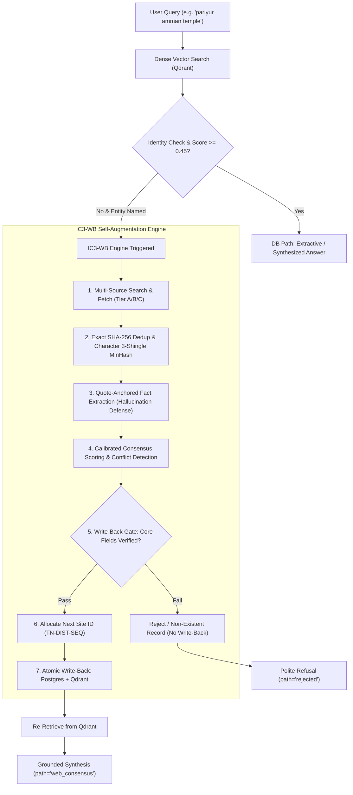

# TamilHeritage-GPT (Level 1)

Multilingual (Tamil / English / Kannada / Tanglish) RAG Chatbot for Tamil Nadu Heritage Sites.

## Prerequisites
- **OS**: Windows 10/11 (PowerShell)
- **Python**: 3.11+ (Python 3.12 recommended)
- **Node.js**: v18+ (tested on v24)
- **PostgreSQL**: 17 running locally on port 5432 with empty database `Heritage_DBJournal`
- **Docker Desktop**: Running for Qdrant vector database

---

## Setup Instructions

### 1. Environment Configuration
Create `server/.env` based on `server/.env.example`:
```powershell
Copy-Item server\.env.example server\.env
```
Fill in your PostgreSQL password in `server/.env`:
```env
DATABASE_URL=postgresql+psycopg://postgres:<PASSWORD>@localhost:5432/Heritage_DBJournal
```

### 2. Python Virtual Environment
```powershell
# Create virtual environment with Python 3.12
uv venv server\.venv --python 3.12

# Install dependencies
uv pip install --python server\.venv\Scripts\python.exe -r server\requirements.txt
```

### 3. Start Qdrant Vector Database
Make sure Docker Desktop is open and running, then start the container:
```powershell
docker compose up -d
```
Qdrant web UI will be available at [http://localhost:6333/dashboard](http://localhost:6333/dashboard).

### 4. Database Migration & Seeding
```powershell
# Apply PostgreSQL schema migration
.\server\.venv\Scripts\python.exe server\scripts\migrate.py

# Seed database, generate embeddings, and populate Qdrant
.\server\.venv\Scripts\python.exe server\scripts\seed.py

# Verify system integrity & row counts
.\server\.venv\Scripts\python.exe server\scripts\check.py
```

### 5. Start Backend Server
```powershell
.\server\.venv\Scripts\python.exe -m uvicorn app.main:app --app-dir server --host 0.0.0.0 --port 8000 --reload
```
Interactive API documentation: [http://localhost:8000/docs](http://localhost:8000/docs)

### 6. Install & Start Frontend (Client)
In a new PowerShell terminal:
```powershell
cd client
npm install
npm run dev
```
Open [http://localhost:5173](http://localhost:5173) in your browser.

---

## Running Verification Tests
```powershell
.\server\.venv\Scripts\python.exe -m pytest server\tests\test_level1.py -v
```

## Level 1 Results

Level 1 benchmark verification passed **7/7 tests** across multilingual semantic retrieval, fuzzy trigram ranking, vector database consistency, and ingestion idempotency.

### 1. Relational & Vector Store Counts
- **Sites registered**: 10 (across 7 primary categories: temple, fort, monument, palace, museum, archaeological_site, memorial)
- **Locations**: 22 (districts, taluks, municipal corporations)
- **Categories**: 11
- **Site Aliases**: 25 (covering English, Tamil script, and Tanglish `ta-Latn`)
- **Sources Curated**: 8
- **Site Facts**: 5
- **PostgreSQL `chunk_registry`**: 30 chunks
- **Qdrant `heritage_chunks` Points**: 30 points (1024-dim dense BAAI/bge-m3 embeddings, Cosine distance)
- **ID Consistency**: 100% exact UUID5 match between PostgreSQL `chunk_registry.chunk_id` and Qdrant vector point IDs
- **Chat Benchmark Records**: 5 users, 5 sessions, 16 messages, 11 citations, 4 feedbacks, 8 query logs

### 2. Multilingual Semantic Search Benchmark
| Query Language | Natural Language Benchmark Query | Target Site ID | Top-1 Predicted Site | Score | Status |
| :--- | :--- | :--- | :--- | :--- | :--- |
| **Tamil (தமிழ்)** | "தஞ்சை பெரிய கோயிலை கட்டியவர் யார்?" | `TN-TNJ-0001` | Brihadeeswarar Temple (`TN-TNJ-0001`) | **0.7106** | **PASS** |
| **English** | "Who built the Big Temple in Thanjavur?" | `TN-TNJ-0001` | Brihadeeswarar Temple (`TN-TNJ-0001`) | **0.6993** | **PASS** |
| **Kannada (ಕನ್ನಡ)** | "ಬನ್ನಾರಿ ಅಮ್ಮನ್ ದೇವಸ್ಥಾನ ಎಲ್ಲಿದೆ?" | `TN-ERD-0001` | Bannari Amman Temple (`TN-ERD-0001`) | **0.6927** | **PASS** |
| **Filtered Search** | "where can I see Chola bronze statues" *(category=museum)* | `TN-CHN-0001` | Government Museum, Chennai (`TN-CHN-0001`) | **0.5905** | **PASS** |
| **Fuzzy / Trigram** | `?q=mahabalipuram shore templ` | `TN-CGL-0001` | Monuments at Mamallapuram (`TN-CGL-0001`) | Rank 1 | **PASS** |

### 3. Pipeline Invariance & Idempotency
- Re-running `seed.py` produces **zero duplicate records** across both relational tables and the Qdrant vector index.
- Vector point count remains invariant at 30 points.

---

## Level 2: Gemini LLM Layer & IC³-WB Self-Augmentation

Level 2 introduces an LLM layer powered by Google Gemini together with an autonomous, reviewer-less self-augmentation engine: **IC³-WB** (*Identity-Checked, Copy-aware Consensus with Calibrated Write-Back*).

### Core Design Principle
> **Gemini only READS and WRITES text.**  
> It classifies user intent, extracts factual claims with verbatim evidence quotes, and synthesizes final answers. Every **accept**, **reject**, **conflict**, and **write-back** decision is strictly executed by deterministic, unit-tested Python code using configurable thresholds.  
> $\text{Same input} + \text{Same config} \implies \text{Same decision}$.

### Configurable Thresholds & Parameters
All thresholds reside in code/configuration, are documented here, and are audited in `augment_jobs.config` for every self-augmentation job:

| Parameter | Value | Location | Purpose & Scientific Rationale |
| :--- | :--- | :--- | :--- |
| `IDENTITY_SIM_THRESHOLD` | `0.55` | `chat_pipeline.py` | Minimum `pg_trgm` similarity required between user entity query and candidate site name/aliases to prevent entity drift. |
| `RETRIEVAL_SCORE_THRESHOLD` | `0.45` | `chat_pipeline.py` | Dense vector cosine similarity cutoff below which IC³-WB self-augmentation is triggered. |
| `MINHASH_JACCARD_THRESHOLD` | `0.70` | `content_dedup.py` | Character 3-shingle MinHash Jaccard similarity cutoff for copycat scrapers / syndication clustering. |
| `TIER_A_PRIOR` | `1.0` | `003_self_augment.sql` | Base reliability for official government & heritage domains (`.gov.in`, `.nic.in`, `asi.nic.in`, `hrce.tn.gov.in`, `whc.unesco.org`). |
| `TIER_B_PRIOR` | `0.6` | `003_self_augment.sql` | Base reliability for encyclopedic & reputable academic/news outlets (`wikipedia.org`, `*.edu`, `thehindu.com`). |
| `TIER_C_PRIOR` | `0.25` | `003_self_augment.sql` | Base reliability for general blogs, commercial travel guides, and uncurated websites. |
| `CONSENSUS_TIER_A_WEIGHT` | `1.0` | `fact_consensus.py` | Minimum support weight from a Tier A authoritative source required to verify a claim immediately. |
| `CONSENSUS_MULTI_CLUSTER_WEIGHT` | `1.2` | `fact_consensus.py` | Minimum cumulative support across $\ge 2$ independent clusters required for Tier B/C claims. |
| `CONFLICT_DELTA_THRESHOLD` | `0.3` | `fact_consensus.py` | Difference threshold between top competing claims; $|S_1 - S_2| \le 0.3$ with $S_1, S_2 \ge 0.8$ yields `conflict`. |
| `AUGMENT_BUDGET_HOURS` | `24` | `augment_orchestrator.py` | Cooldown period per `candidate_key` preventing redundant external queries and quota exhaustion. |

### IC³-WB Algorithm Stages


1. **Identity-Checked Gating**: When a user mentions a specific entity (e.g., "pariyur amman temple"), the system verifies whether top retrieved candidates match the target entity (trigram similarity $\ge 0.55$ and matching district). If similarity fails, drift is blocked (preventing Bannari Amman from answering Pariyur Amman).
2. **Multi-Source Collection**: Retrieves candidate URLs across Tier A (`asi.nic.in`, `hrce.tn.gov.in`, `tnarch.gov.in`), Tier B (Wikipedia, reputable press), and Tier C.
3. **Copy-Aware Clustering**: Computes SHA-256 for identical pages, plus MinHash signatures over character 3-shingles with Jaccard similarity $\ge 0.70$. Scraped/syndicated copycats are grouped into a single cluster to prevent false consensus.
4. **Quote-Anchored Extraction (Hallucination Defense)**: Gemini extracts candidate facts (`builder`, `period`, `deity`, `history`, `overview`), but every claim **must include a verbatim quote**. If the quote does not exist as an exact substring in the retrieved web page, the claim is dropped immediately.
5. **Calibrated Consensus Scoring**: Computes claim weight $W_c = \max_{s \in \text{cluster}} (\text{tier\_prior}_s \times \text{reliability}_s)$. Evaluates whether a claim is `verified`, `conflict`, or `rejected`.
6. **Dual Atomic Write-Back**: Only candidates meeting all core fields (`name_en`, `primary_category`, `district_id`, `overview`, `history`/`period`/`builder`) pass write-back gating. Sequential site IDs (`TN-<DIST>-<SEQ>`) are allocated, and records are atomically persisted to PostgreSQL (`sites`, `site_facts`, `chunk_registry`) and Qdrant (`heritage_chunks`).
7. **Immediate Re-retrieval & Provenance Tracking**: Re-queries Qdrant for newly created vectors, synthesizes the answer with citations (`origin="web_consensus"`), and logs full audit metadata to `augment_jobs`, `augment_sources`, `evidence_ledger`, `field_decisions`, and `query_logs`.

