# Current, As-Implemented Workflow of Chat + Self-Augmentation Pipeline

> **Scope**: READ-ONLY audit of the TamilHeritage-GPT conversational and self-augmentation pipeline as actually implemented in source code and verified against live PostgreSQL and Qdrant databases.
> **Codebase Target**: `server/app/services/chat_pipeline.py`, `server/app/services/augment_orchestrator.py`, `server/app/services/gemini.py`, `server/app/services/writeback.py`, `server/app/services/fact_consensus.py`, `server/app/services/content_dedup.py`, `server/app/services/domain_tiers.py`, `server/app/augment/clarify.py`, `server/app/augment/disambiguate.py`.

---

## Part 1: End-to-End Flow Diagram

```mermaid
flowchart TD
    Start(["User submits query<br/>(POST /api/chat/sessions/{id}/messages)"]) --> D_Idem{"In-Memory Idempotency?<br/>(chat_pipeline.py:526)<br/><code>(str(session_id), key) in _IDEMPOTENCY_CACHE</code>"}

    D_Idem -- "True (Cached)" --> Out_IdemCache["Return cached ChatMessageResponse<br/>(0 DB / 0 Gemini calls)"]
    D_Idem -- "False" --> Check_Session{"Session Exists?<br/>(chat_pipeline.py:534)<br/><code>SELECT session_id FROM chat_sessions</code>"}

    Check_Session -- "False" --> Err_404["Raise ValueError (HTTP 404)<br/>'Chat session not found'"]
    Check_Session -- "True" --> D_RapidDouble{"Rapid Double-Post Guard?<br/>(chat_pipeline.py:546)<br/><code>role='user' AND content=:c<br/>AND created_at >= (now() - interval '3s')</code>"}

    D_RapidDouble -- "True" --> Out_RapidDB["Reconstruct prior assistant reply from DB<br/>Populate _IDEMPOTENCY_CACHE and return"]
    D_RapidDouble -- "False" --> D_ClarOpen{"Open Clarification Exists?<br/>(chat_pipeline.py:595)<br/><code>get_open_clarification(db, session_id)</code>"}

    %% Clarification Branch
    D_ClarOpen -- "Yes (Clarification open)" --> Sub_Clar["process_clarification_reply()<br/>(clarify.py:60)"]
    Sub_Clar --> D_ClarMatch{"Option matched?<br/>(clarify.py:80,98)<br/><code>'option_id' in payload OR<br/>SequenceMatcher >= 85%</code>"}
    D_ClarMatch -- "Matched" --> Clar_Resolve["resolve_clarification(status='resolved')<br/>Enrich query: entity + locality + district<br/>(chat_pipeline.py:604)"] --> Step_Lang
    D_ClarMatch -- "Not Matched" --> Clar_Cancel["cancel_clarification(status='cancelled')<br/>Query remains original text<br/>(clarify.py:105)"] --> Step_Lang

    %% Language Detection
    D_ClarOpen -- "No" --> Step_Lang["detect_language(clean_content)<br/>(chat_pipeline.py:64)"]
    Step_Lang --> D_LangCheck{"Script / Tanglish Check<br/>(chat_pipeline.py:69-98)"}
    D_LangCheck -- "Unicode [\u0B80-\u0BFF]" --> L_Ta["lang = 'ta'"] --> D_Greet
    D_LangCheck -- "Unicode [\u0C80-\u0CFF]" --> L_Kn["lang = 'kn'"] --> D_Greet
    D_LangCheck -- "Markers / suffixes / multi-words" --> L_Tgl["lang = 'ta-Latn'"] --> D_Greet
    D_LangCheck -- "Fallback" --> L_En["lang = 'en'"] --> D_Greet

    %% Greeting Check
    D_Greet{"is_greeting(clean_content)?<br/>(chat_pipeline.py:380)<br/>clean in GREETING_WORDS (20 words)<br/>OR (<=3 tokens AND greeting root AND no heritage clues)"}
    D_Greet -- "True" --> Act_Greet["Generate GREETING_RESPONSES[lang]<br/>INSERT chat_messages (user + asst)<br/>INSERT query_logs (path='greeting', top_score=1.0)<br/>UPDATE chat_sessions title & last_message_at<br/>(chat_pipeline.py:622-675)"]
    Act_Greet --> Out_Greet["Return ChatMessageResponse (path='greeting')"]

    %% Question Classification & Entity Extraction
    D_Greet -- "False" --> Step_Classify["classify_question_type(clean_content)<br/>(chat_pipeline.py:104)<br/>10 regex/keyword rules"]
    Step_Classify --> Step_Linking["Entity Linking:<br/>1. detect_site(): pg_trgm similarity(alias_norm, :q) >= 0.4<br/>2. detect_district(): locations WHERE level='district' + aliases<br/>(chat_pipeline.py:300-340)"]
    Step_Linking --> Step_Qdrant["Qdrant Vector Retrieval:<br/>bge-m3 dense 1024-dim embedding<br/>Filter: site_id if resolved, else district if detected; limit=8<br/>Fallback: unfiltered search if resolved_site and hits[0].score < 0.40<br/>Rerank: language boost (+0.01 to +0.05)<br/>(chat_pipeline.py:398-510)"]

    %% Identity Verification
    Step_Qdrant --> D_HitsExist{"Hits returned from Qdrant?"}
    D_HitsExist -- "No hits" --> G_AugCheck
    D_HitsExist -- "Hits present" --> Step_Identity["verify_identity(db, candidate_site, query, district)<br/>(chat_pipeline.py:235-297)"]
    Step_Identity --> D_IdVerify{"Identity Valid?<br/>1. District mismatch -> Reject<br/>2. pg_trgm max_sim >= 0.55 -> Accept<br/>3. Fallback word_sim >= 0.70 -> Accept"}
    D_IdVerify -- "Valid / No entity named" --> G_AugCheck
    D_IdVerify -- "Mismatch / sim < 0.55" --> G_AugCheck

    %% Augmentation Trigger Gate
    G_AugCheck{"needs_augmentation?<br/>(chat_pipeline.py:743)<br/><code>(q_type != 'out_of_scope') AND<br/>(top_score < 0.45 OR not ranked_chunks OR not identity_valid)</code>"}

    %% BRANCH A: Self-Augmentation
    G_AugCheck -- "True" --> D_EntityExtracted{"extract_entity_name(clean_content)?<br/>(chat_pipeline.py:746)<br/>Length >= 3 chars & not categorical"}
    D_EntityExtracted -- "None / < 3 chars" --> Path_Reject
    D_EntityExtracted -- "Entity Extracted" --> Call_Aug["run_augmentation_pipeline()<br/>(augment_orchestrator.py:218)"]

    %% Self-Augmentation Sub-pipeline
    Call_Aug --> Aug_Classify["Gemini classify_query(query)<br/>(gemini.py:142)<br/>Outputs: entity_name, place_name, district_id, is_heritage"]
    Aug_Classify --> D_IsHeritage{"is_heritage == True AND<br/>entity_name is not None?<br/>(augment_orchestrator.py:260)"}
    D_IsHeritage -- "False" --> Aug_NonHeritage["status='rejected_nonexistent'<br/>reason='non-heritage or no entity named'"] --> Path_Reject

    D_IsHeritage -- "True" --> Aug_CandidateKey["candidate_key = normalize(entity_name) + '|' + (district_id or 'unknown')<br/>(augment_orchestrator.py:65)"]
    Aug_CandidateKey --> D_Budget{"24-Hour Budget Check<br/>(augment_orchestrator.py:277)<br/><code>SELECT job_id, status, site_id FROM augment_jobs<br/>WHERE candidate_key=:ck AND started_at >= (now() - interval '24 hours')</code>"}

    D_Budget -- "Found & status='verified' & site_id" --> Aug_Reused["status='verified' (Reused)<br/>site_id=recent_job.site_id<br/>reason='Reused verified site from previous job within 24h budget window.'"] --> Aug_PostQdrant
    D_Budget -- "Found & not verified" --> Aug_Skipped["status='skipped_budget'<br/>reason='24-hour augmentation budget exceeded for this entity candidate.'"] --> Path_Reject
    D_Budget -- "No recent job (Budget OK)" --> Aug_InsertJob["INSERT INTO augment_jobs (status='running')<br/>(augment_orchestrator.py:315)"]

    Aug_InsertJob --> Aug_Web["Multi-source Web Retrieval (max 8 URLs):<br/>1. DuckDuckGo (ddgs, max 5)<br/>2. Wikipedia API (srsearch, max 3)<br/>3. Wikidata Search (sitelinks, P856)<br/>4. HRCE companion URL expansion<br/>(augment_orchestrator.py:87-196)"]
    Aug_Web --> Aug_Fetch["Fetch & Deduplicate (httpx, timeout=7s):<br/>- strip_html_tags, skip text < 50 chars<br/>- SHA256 exact match deduplication<br/>- Tier: *.nic.in/*.gov.in -> 'A' (1.0); *.ac.in/*.edu -> 'B' (0.6); else 'C' (0.25)<br/>- MinHash (64-perm, 3-shingles, Jaccard >= 0.70) clustering<br/>- Relevance filter: page_mentions_entity()<br/>- INSERT augment_sources (used=True for top 5 relevant)<br/>(augment_orchestrator.py:355-430)"]

    Aug_Fetch --> Aug_Extract["Gemini Claim Extraction (top 5 pages):<br/>Target fields: name_en, name_ta, primary_category, district_id,<br/>overview, history, builder, period, dynasty, built_year, deity<br/>Hallucination Defense: quote must exist verbatim in page text!<br/>INSERT evidence_ledger<br/>(augment_orchestrator.py:434-483; gemini.py:248-346)"]

    Aug_Extract --> Aug_Consensus["Deterministic Fact Consensus (evaluate_field_consensus):<br/>- Canonical normalizers: builder, deity, year, category<br/>- Weight = domain_prior * (1.0 if agreement else 0.7)<br/>- Copycat discount: max weight per cluster_key<br/>- Rules: Tier A (has_tier_a & support >= 1.0) -> 'verified'<br/>- Multi-cluster (clusters >= 2 & support >= 1.2) -> 'verified'<br/>- Conflict (top-2 competing support >= 0.8) -> 'conflict'<br/>- Else -> 'rejected'<br/>- Injects: anchor name_en, resolve district_id<br/>(fact_consensus.py:196-359; augment_orchestrator.py:486-533)"]

    Aug_Consensus --> Aug_Gate{"Write-Back Gate (check_writeback_gate):<br/>(writeback.py:36-60)<br/>1. Core fields verified: name_en, primary_category,<br/>district_id, overview, history<br/>2. Context verified: >=1 of builder, period, dynasty, built_year"}
    Aug_Gate -- "Gate Failed" --> Aug_WriteFail["status='rejected_nonexistent' (if 0 verified fields) or 'failed'<br/>UPDATE augment_jobs<br/>(writeback.py:96-112)"] --> Path_Reject
    Aug_Gate -- "Gate Passed" --> Aug_Write["execute_writeback():<br/>- allocate_next_site_id: TN-{code3}-{seq:04d}<br/>- INSERT sites (status='verified', trust, origin='web_consensus')<br/>- INSERT site_aliases (en, ta)<br/>- INSERT field_decisions (ON CONFLICT DO UPDATE)<br/>- INSERT site_facts (verified fields)<br/>- Embed overview & history -> INSERT chunk_registry<br/>- Upsert Qdrant points<br/>- UPDATE augment_jobs (status='verified', site_id)<br/>(writeback.py:83-346)"] --> Aug_PostQdrant

    Aug_PostQdrant{"Augment verified & site_id present?<br/>(chat_pipeline.py:764)"}
    Aug_PostQdrant -- "Yes" --> Aug_ReSearch["Re-run Qdrant retrieval for newly written site_id<br/>(chat_pipeline.py:766)"]
    Aug_PostQdrant -- "No" --> Path_Reject

    Aug_ReSearch --> D_NewChunks{"New chunks retrieved?"}
    D_NewChunks -- "Yes" --> Path_WebConsensus["path='web_consensus'<br/>Select top 1-2 chunks for citations<br/>Synthesize grounded answer via gemini_synthesize_answer()<br/>(chat_pipeline.py:776-808)"] --> Step_Persist
    D_NewChunks -- "No" --> Path_Reject

    %% BRANCH B: Rejection Path
    G_AugCheck -- "q_type == 'out_of_scope' OR not ranked_chunks" --> Path_Reject["path='rejected'<br/>citations = []<br/>content = REJECTION_MESSAGES[lang]<br/>(chat_pipeline.py:810,817,825,832,839)"] --> Step_Persist

    %% BRANCH C: Database Path
    G_AugCheck -- "False (top_score >= 0.45 & identity_valid)" --> Path_DB["path='db'<br/>Select chunk[0], plus chunk[1] if same site_id & raw_score >= 0.45<br/>content = LANG_PREFIX_TEMPLATES[lang] + chunk texts<br/>Build citations from chunk_registry + sources<br/>(chat_pipeline.py:846-886)"] --> Step_Persist

    %% Persistence
    Step_Persist["Atomic PostgreSQL Persistence:<br/>1. INSERT chat_messages (user)<br/>2. INSERT chat_messages (assistant, reply_to=user)<br/>3. INSERT message_citations (ON CONFLICT DO NOTHING)<br/>4. INSERT query_logs (path, top_score, path_detail, gemini_calls)<br/>5. UPDATE chat_sessions (last_message_at, title)<br/>COMMIT transaction<br/>(chat_pipeline.py:890-977)"] --> End_Resp["Return ChatMessageResponse to client"]
```



---

## Part 2: Stage-by-Stage Table

| # | Stage | file:function | Input | Exact condition(s) / threshold(s) | Output | Next stage on each branch | External calls (Gemini / web / DB) | Typical latency |
|---|---|---|---|---|---|---|---|---|
| **0a** | In-Memory Idempotency | `chat_pipeline.py:process_chat_message` | `idempotency_key`, `session_id` | `if idempotency_key: cache_key = (str(session_id), str(idempotency_key).strip())` in `_IDEMPOTENCY_CACHE` | Cached `ChatMessageResponse` or None | Match: return early; Miss: stage 0b | In-memory dict lookup | < 1 ms |
| **0b** | Session Verification | `chat_pipeline.py:process_chat_message` | `session_id` | `SELECT session_id, user_id, title FROM chat_sessions WHERE session_id = :sid` | Row or None | Found: stage 0c; Missing: raise HTTP 404 | PostgreSQL `chat_sessions` | 1 - 3 ms |
| **0c** | Rapid Duplicate Guard | `chat_pipeline.py:process_chat_message` | `session_id`, `content` | `WHERE m.session_id = :sid AND m.role = 'user' AND m.content = :content AND m.created_at >= (now() - interval '3 seconds')` (hard-coded: 3 s) | Prior `message_id` or None | Found: reconstruct assistant response, cache & return; None: stage 0d | PostgreSQL `chat_messages` | 2 - 4 ms |
| **0d** | Clarification Pre-hook | `chat_pipeline.py:process_chat_message` calling `clarify.py:process_clarification_reply` | `session_id`, `clean_content` | `get_open_clarification(db, session_id)` status == `'open'` and `created_at >= (now() - 30 min)`. Match: `option_id` exact OR `SequenceMatcher >= 85%` (hard-coded: 85%) | Status: `resolved` / `cancelled` / `unresolved`, rewritten query | Resolved: rewrite query, proceed to stage 1. Cancelled/Unresolved: proceed to stage 1 | PostgreSQL `clarifications` | 3 - 8 ms |
| **1** | Language Detection | `chat_pipeline.py:detect_language` | `clean_content` (str) | 1. `[\u0B80-\u0BFF]` -> `ta`<br/>2. `[\u0C80-\u0CFF]` -> `kn`<br/>3. Tanglish: 8 multi-word phrases, 55 `TANGLISH_MARKERS`, suffix regex, or `-la/-ku/-oda/-le/-kku/-lerundhu`<br/>4. Fallback -> `en` | Language code: `ta`, `kn`, `ta-Latn`, `en` | Stage 1b | CPU regex / token checks (no I/O) | < 1 ms |
| **1b** | Greeting Fast-Path | `chat_pipeline.py:is_greeting` | `clean_content`, `detected_lang` | Punctuation stripped, lowercased. Exact match in `GREETING_WORDS` (20 words) OR (`len(tokens) <= 3` and starts with greeting token and no heritage clue word) | Boolean `is_greeting` | True: stage 7 (path='greeting'); False: stage 2 | None (DB write only if True) | < 1 ms |
| **2** | Question Classification | `chat_pipeline.py:classify_question_type` | `clean_content` | Sequential lowercased substring checks across 9 categories (`out_of_scope`, `history`, `location`, `timings_entry`, `festival`, `how_to_reach`, `architecture`, `recommendation`, `comparison`), fallback `general_heritage` | One of 10 controlled codes | Stage 3 | CPU string matching | < 1 ms |
| **3a** | Site Detection | `chat_pipeline.py:detect_site` | `clean_content` | `SELECT site_id FROM site_aliases WHERE similarity(alias_norm, :q) >= 0.4 ORDER BY sim DESC, length(alias_norm) DESC LIMIT 1` (hard-coded: 0.4) | `site_id` (str) or `None` | Stage 3b | PostgreSQL `site_aliases` (pg_trgm) | 3 - 6 ms |
| **3b** | District Detection | `chat_pipeline.py:detect_district` | `clean_content` | `SELECT name_en, name_ta FROM locations WHERE level = 'district'`, plus manual alias mapping for 4 districts (`kanyakumari`, `tanjore/thanjai`, `trichy`, `tuticorin`) | District `name_en` or `None` | Stage 4 | PostgreSQL `locations` | 2 - 4 ms |
| **4** | Dense Vector Retrieval | `chat_pipeline.py:search_and_rank_chunks` | `query_text`, `query_lang`, `resolved_site`, `detected_district` | Embed query via `bge-m3` (dense 1024-dim). Query Qdrant with filter (`site_id` or `district`), `limit=8`. Fallback: if `resolved_site` hits empty or `hits[0].score < 0.40` (hard-coded: 0.40), run unfiltered search. Language boost: +0.01 to +0.05. Sort by `effective_score DESC` | List of ranked chunk dicts (max 8) | Stage 5 | PyTorch/CUDA embedding + Qdrant REST/gRPC | 120 - 250 ms |
| **5** | Identity Verification | `chat_pipeline.py:verify_identity` | `candidate_site_id`, `query`, `detected_district` | 1. `extract_entity_name(query)` strips frames/suffixes.<br/>2. If district detected, must match candidate district.<br/>3. `GREATEST(similarity(name_en), similarity(name_ta), max_alias.sim) >= 0.55` (hard-coded: 0.55).<br/>4. Fallback: `word_similarity >= 0.70` on aliases >= 6 chars | `(is_match: bool, similarity: float, reason: str)` | Stage 6 | PostgreSQL `sites`, `locations`, `site_aliases` | 3 - 8 ms |
| **6** | Augmentation Gate Decision | `chat_pipeline.py:process_chat_message` | `q_type`, `top_score`, `ranked_chunks`, `identity_valid` | `needs_augmentation = (q_type != 'out_of_scope') and (top_score < 0.45 or not ranked_chunks or not identity_valid)` (hard-coded: 0.45) | Boolean `needs_augmentation` | True: stage 6a (Augmentation); False & out_of_scope/empty: stage 7 (path='rejected'); False & valid: stage 6i (path='db') | None | < 1 ms |
| **6a** | Augmentation Query Classification | `gemini.py:classify_query` | `query` (str) | If `settings.GEMINI_API_KEY`: prompt Gemini (`gemini-flash-lite-latest`, temp 0.1, timeout 30s) -> JSON with `is_heritage`, `entity_name`, `entity_name_ta`, `place_name`, `question_type`, `lang`. Else fallback to regex functions | Dict classification | `is_heritage` is False or `entity_name` is None: stage 7 (status='rejected_nonexistent'); Else: stage 6b | Google Gemini REST API | 1200 - 2500 ms |
| **6b** | Candidate Key & 24h Budget Check | `augment_orchestrator.py:run_augmentation_pipeline` | `entity_name`, `district_id` | `candidate_key = normalize(entity_name) + '\|' + (district_id or 'unknown')`. Query `augment_jobs WHERE candidate_key = :ck AND started_at >= (now() - interval '24 hours') ORDER BY started_at DESC LIMIT 1` (hard-coded: 24h) | Recent job or None | Found & verified: return site_id (reused); Found & not verified: abort (status='skipped_budget'); None: stage 6c | PostgreSQL `augment_jobs` | 2 - 5 ms |
| **6c** | Web URL Retrieval | `augment_orchestrator.py:default_web_search` | `search_query` | Query cleaned. DDGS text search (max 5), Wikipedia API `srsearch` (max 3), Wikidata `wbsearchentities` + sitelinks + P856 (max 1), HRCE page generation. URLs deduplicated; capped at 8 (hard-coded: 8) | List of candidate URLs (max 8) | Stage 6d | DuckDuckGo, Wikipedia API, Wikidata API | 1500 - 4000 ms |
| **6d** | Page Fetching & Deduplication | `augment_orchestrator.py:run_augmentation_pipeline` | `candidate_urls` | `httpx.get` (timeout 7.0s, hard-coded). `strip_html_tags`. Skip if text < 50 chars. SHA256 of text: skip exact duplicate. `get_domain_tier`: *.nic.in/*.gov.in -> Tier A (1.0); *.ac.in/*.edu -> Tier B (0.6); else Tier C (0.25). MinHash (64-perm, Jaccard >= 0.70) clustering. `page_mentions_entity()` relevance filter. INSERT `augment_sources` | List of clustered, relevant sources (max 5 marked `used=True`) | Stage 6e | HTTP GET (up to 8 external hosts) + PostgreSQL `augment_sources`, `source_domains` | 2000 - 7000 ms |
| **6e** | Grounded Claim Extraction | `gemini.py:extract_claims` | `page_text[:12000]`, `entity_name`, `place_name` | Call Gemini (temp 0.1, json_response=True). Strict Hallucination Defense: `quote in page_text or quote_clean in page_clean`. Claims failing quote check are discarded. INSERT `evidence_ledger` | List of validated claims with exact quotes | Stage 6f | Google Gemini REST API (1 call per source page, max 5) + PostgreSQL `evidence_ledger` | 2500 - 6000 ms |
| **6f** | Fact Consensus Engine | `fact_consensus.py:evaluate_field_consensus` | Target fields, extracted claims | Normalizers (year, builder, deity, category). Weight = `prior * (1.0 if agreement else 0.7)`. Copycat discount: `max(weight)` per cluster. Decision rules:<br/>- Conflict: top-2 competing both have support >= 0.8 (hard-coded)<br/>- Verified Rule 1: `has_tier_a and support >= 1.0`<br/>- Verified Rule 2: `n_clusters >= 2 and support >= 1.2`<br/>- Rejected: else | Dict of `FieldDecisionResult` per field | Stage 6g | CPU computation | < 5 ms |
| **6g** | Write-Back Gating | `writeback.py:check_writeback_gate` | `decisions` dict | 1. All 5 core fields must be 'verified' with value: `name_en`, `primary_category`, `district_id`, `overview`, `history`.<br/>2. At least 1 historical field must be 'verified' with value: `builder`, `period`, `dynasty`, `built_year` | `(gate_passed: bool, reason: str)` | Gate passed: stage 6h; Gate failed: UPDATE `augment_jobs` (status='rejected_nonexistent' if 0 verified else 'failed'), proceed to stage 7 (path='rejected') | PostgreSQL `augment_jobs` | 2 - 5 ms |
| **6h** | Atomic Write-Back Persistence | `writeback.py:execute_writeback` | `decisions`, `candidate_key`, `job_id` | 1. `allocate_next_site_id`: `TN-{code3}-{seq:04d}`.<br/>2. INSERT `sites` (status='verified', origin='web_consensus').<br/>3. INSERT `site_aliases`.<br/>4. INSERT `field_decisions` (ON CONFLICT DO UPDATE).<br/>5. INSERT `site_facts` for verified fields.<br/>6. Embed overview & history via `bge-m3` -> INSERT `chunk_registry`.<br/>7. Upsert vectors to Qdrant collection `heritage_chunks`.<br/>8. UPDATE `augment_jobs` (status='verified', site_id) | `allocated_site_id` (str) | Stage 6i | PyTorch embedding + Qdrant upsert + PostgreSQL multi-table inserts | 250 - 500 ms |
| **6i** | Post-Augmentation Retrieval & Synthesis | `chat_pipeline.py:process_chat_message` | `allocated_site_id`, `clean_content` | Re-run `search_and_rank_chunks` with `resolved_site=allocated_site_id`. If hits found: path='web_consensus', select top 1-2 chunks, call `gemini_synthesize_answer` (temp 0.1, timeout 30s) | Synthesized grounded answer string, citations list | Stage 7 | Qdrant retrieval + Google Gemini REST API | 1500 - 3000 ms |
| **6j** | Direct DB Extraction | `chat_pipeline.py:process_chat_message` | `ranked_chunks`, `detected_lang` | Path='db'. Select `chunk[0]`. If `len(ranked_chunks) > 1` and `chunk[1].site_id == chunk[0].site_id` and `chunk[1].raw_score >= 0.45` (hard-coded: 0.45), include `chunk[1]`. Format answer: `LANG_PREFIX_TEMPLATES[lang] + texts`. Citations populated from `chunk_registry` and `sources` | Formatted answer string, citations list | Stage 7 | PostgreSQL `sources` (for source URL lookup) | 2 - 5 ms |
| **7** | Response Persistence & Commit | `chat_pipeline.py:process_chat_message` | `user_message`, `assistant_message`, `query_logs` | 1. INSERT `chat_messages` (user).<br/>2. INSERT `chat_messages` (assistant).<br/>3. INSERT `message_citations` (ON CONFLICT DO NOTHING).<br/>4. INSERT `query_logs` (path, top_score, path_detail, gemini_calls).<br/>5. UPDATE `chat_sessions` (last_message_at, title).<br/>6. `db.commit()` | Completed turn persisted to DB | Return `ChatMessageResponse` to client | PostgreSQL multi-table insert | 5 - 15 ms |

---

## Part 3: Decision Catalogue

| file:line | Quoted Condition | Resulting Status / Path | `decision_reason` Text Produced | What Gets Stored | What the User Sees |
|---|---|---|---|---|---|
| `chat_pipeline.py:526` | `if cache_key in _IDEMPOTENCY_CACHE:` | Prior cached response path | None | Nothing written | Prior cached assistant response |
| `chat_pipeline.py:548` | `m.session_id = :sid AND m.role = 'user' AND m.content = :content AND m.created_at >= (now() - interval '3 seconds')` | Prior response path (path='db' reconstruct) | None | Nothing written | Prior assistant message content |
| `chat_pipeline.py:617` | `if is_greeting(clean_content):` | `path = 'greeting'` | `None` (logged in `query_logs.path='greeting'`) | `chat_messages` (2 rows), `query_logs` (top_score=1.0, gemini_calls=0), `chat_sessions` | Conversational greeting string (`GREETING_RESPONSES[lang]`) |
| `chat_pipeline.py:281` | `if detected_district and site_district and detected_district.lower() != site_district.lower():` | `identity_valid = False` | Internal: `f"district_mismatch ({site_district} != {detected_district})"` | Logged to application logger | Triggers self-augmentation or polite refusal |
| `chat_pipeline.py:285` | `if max_sim < 0.55:` (with fallback `w_sim < 0.70`) | `identity_valid = False` | Internal: `f"similarity_too_low ({max_sim:.3f} < 0.55)"` | Logged to application logger | Triggers self-augmentation or polite refusal |
| `chat_pipeline.py:743` | `needs_augmentation = (q_type != "out_of_scope") and (top_score < 0.45 or not ranked_chunks or not identity_valid)` | Triggers self-augmentation branch | Passed to orchestrator | Determined by orchestrator outcome | Pipeline branches to augment or refusal |
| `chat_pipeline.py:746` | `if extracted_entity:` is False | `path = 'rejected'` | `None` | `chat_messages` (2 rows), `query_logs` (path='rejected') | `REJECTION_MESSAGES[lang]` |
| `augment_orchestrator.py:260` | `if not is_heritage or not entity_name:` | `status = 'rejected_nonexistent'` | `"Query was classified as non-heritage or no specific entity was named."` | `query_logs.path_detail` (status, reason) | `REJECTION_MESSAGES[lang]` |
| `augment_orchestrator.py:289` | `if recent_job["site_id"] and recent_job["status"] == "verified":` | `status = 'verified'` (reused) | `"Reused verified site from previous job within 24h budget window."` | `query_logs.path_detail` (status, reason, site_id) | Synthesized answer from reused site chunks |
| `augment_orchestrator.py:301` | `else:` (recent job found within 24h but not verified) | `status = 'skipped_budget'` | `"24-hour augmentation budget exceeded for this entity candidate."` | `query_logs.path_detail` (status, reason) | `REJECTION_MESSAGES[lang]` |
| `content_dedup.py:368` | `if sha256_hash in seen_hashes:` | Skip duplicate page | `None` | Page skipped from `augment_sources` | User does not see; deduplicated internally |
| `content_dedup.py:116` | `if not page_mentions_entity(text, entity_name):` | `mentions_entity = False` | `None` | `augment_sources.mentions_entity = FALSE`, `used = FALSE` | User does not see; excluded from claim extraction |
| `gemini.py:326` | `if not (quote in page_text or quote_clean in page_clean):` | Claim rejected (hallucination defense) | Logged: `f"quote '{quote[:60]}...' was not found verbatim in page text."` | Claim discarded; NOT written to `evidence_ledger` | User does not see hallucinated claim |
| `fact_consensus.py:311` | `if top_val["support"] >= 0.8 and second_val["support"] >= 0.8:` | `decision = 'conflict'` | `rule_fired = 'conflict_competing_high_support'` | `field_decisions.decision = 'conflict'` | Field excluded from `site_facts` |
| `fact_consensus.py:324` | `if top_val["has_tier_a"] and top_val["support"] >= 1.0:` | `decision = 'verified'` | `rule_fired = 'verified_tier_a_authoritative'` | `field_decisions.decision = 'verified'`, stored to `site_facts` | Contributes to verified site knowledge |
| `fact_consensus.py:337` | `if top_val["n_clusters"] >= 2 and top_val["support"] >= 1.2:` | `decision = 'verified'` | `rule_fired = 'verified_multi_cluster_consensus'` | `field_decisions.decision = 'verified'`, stored to `site_facts` | Contributes to verified site knowledge |
| `fact_consensus.py:350` | `else:` (support < threshold) | `decision = 'rejected'` | `rule_fired = 'rejected_insufficient_support'` | `field_decisions.decision = 'rejected'` | Field excluded from `site_facts` |
| `writeback.py:50` | `if missing_core:` | Write-back gate failed | `f"Missing required verified core fields: {', '.join(missing_core)}"` | `augment_jobs.status = ('rejected_nonexistent' or 'failed')` | `REJECTION_MESSAGES[lang]` |
| `writeback.py:57` | `if not has_historical:` | Write-back gate failed | `f"Must verify at least one of: {', '.join(sorted(HISTORICAL_CONTEXT_FIELDS))}"` | `augment_jobs.status = 'failed'` | `REJECTION_MESSAGES[lang]` |
| `writeback.py:60` | `return (True, ...)` | Write-back gate passed | `"All write-back gating requirements satisfied."` | `augment_jobs.status = 'verified'`, `sites`, `site_facts`, `chunk_registry`, Qdrant | Newly written site retrieved and synthesized |
| `chat_pipeline.py:764` | `if aug_res.status == "verified" and aug_res.site_id:` (and `new_ranked` hits found) | `path = 'web_consensus'` | `None` (recorded in `path_detail`) | `chat_messages`, `message_citations`, `query_logs` | Gemini synthesized answer based on newly written chunks |
| `chat_pipeline.py:810, 817, 825, 832` | `else:` (augmentation failed or did not yield verified chunks) | `path = 'rejected'` | Recorded in `path_detail` from `aug_res.decision_reason` | `chat_messages` (2 rows), `query_logs` (path='rejected') | `REJECTION_MESSAGES[lang]` |
| `chat_pipeline.py:838` | `elif q_type == "out_of_scope" or not ranked_chunks:` | `path = 'rejected'` | `None` | `chat_messages` (2 rows), `query_logs` (path='rejected') | `REJECTION_MESSAGES[lang]` |
| `chat_pipeline.py:846` | `else:` (normal vector retrieval pass) | `path = 'db'` | `None` | `chat_messages`, `message_citations`, `query_logs` | Extractive prefix + chunks text |

### Distinct Status Values Produced in Code

1. **`query_logs.path`**: `'greeting'`, `'db'`, `'rejected'`, `'web_consensus'`, `'needs_clarification'`
2. **`augment_jobs.status`**: `'running'`, `'verified'`, `'rejected_nonexistent'`, `'failed'`, `'skipped_budget'`
3. **`field_decisions.decision`**: `'verified'`, `'conflict'`, `'rejected'`, `'expired'`
4. **`site_facts.status` / `site_facts.decision`**: `'verified'`, `'pending'`, `'conflict'`
5. **`sites.status`**: `'verified'`, `'pending'`, `'rejected'`
6. **`sites.trust`**: `'official'`, `'multi_source'`, `'single_source'`, `'unverified'`
7. **`clarifications.status`**: `'open'`, `'resolved'`, `'cancelled'`, `'expired'`

### Distinct `decision_reason` Strings Produced in Code

1. `"Query was classified as non-heritage or no specific entity was named."` (`augment_orchestrator.py:261`)
2. `"Reused verified site from previous job within 24h budget window."` (`augment_orchestrator.py:297`)
3. `"24-hour augmentation budget exceeded for this entity candidate."` (`augment_orchestrator.py:309`)
4. `"All write-back gating requirements satisfied."` (`writeback.py:60`)
5. `"Missing required verified core fields: {fields}"` (`writeback.py:51`)
6. `"Must verify at least one of: builder, built_year, dynasty, period"` (`writeback.py:58`)
7. `"Successfully verified and wrote back site {site_id} ({name_en})"` (`writeback.py:339`)
8. `"Pipeline failure: {error}"` (`augment_orchestrator.py:595`)

---

## Part 4: Storage Matrix (Which Table Gets What, When)

### Per-Table Detailed Specifications

#### 1. `users`
- **When written**: Only during user signup or guest user creation (`POST /api/users/guest`). NOT written during standard message chat turns.
- **Columns filled**: `auth_provider` (`'guest'`), `role` (`'user'`), `consent_logging` (`FALSE`), `user_id` (auto UUID), `created_at` (`now()`).
- **Mode**: `INSERT INTO users ... RETURNING user_id`.
- **Transaction**: Dedicated transaction committed immediately upon user creation route.

#### 2. `chat_sessions`
- **When written**: Created on `POST /api/chat/sessions`. Updated on every message turn (both greeting and normal turns).
- **Columns updated**: `last_message_at = now()`, `title = CASE WHEN title IS NULL OR title = 'New Chat' THEN :short_title ELSE title END`.
- **Mode**: `UPDATE chat_sessions SET ... WHERE session_id = :sid`.
- **Transaction**: Committed at the end of `process_chat_message`.

#### 3. `chat_messages`
- **When written**: Written on **EVERY** turn that completes without unhandled exception (both greeting, db, web_consensus, and rejected turns). Exactly 2 rows inserted per turn: 1 user message, 1 assistant message.
- **Columns filled**:
  - User: `session_id`, `role='user'`, `content`, `lang`, `question_type`, `resolved_site`, `reply_to=NULL`, `created_at=now()`
  - Assistant: `session_id`, `role='assistant'`, `content`, `lang`, `question_type=NULL`, `resolved_site`, `reply_to=user_message_id`, `created_at=now()`
- **Mode**: `INSERT INTO chat_messages (...) VALUES (...) RETURNING message_id, created_at`.
- **Transaction**: Committed at the end of `process_chat_message`.

#### 4. `message_citations`
- **When written**: Written ONLY when `citations` list is non-empty:
  - On `path='db'` (1 to 2 citations inserted).
  - On `path='web_consensus'` (1 to 2 citations inserted).
  - **NOT written** on `path='greeting'` or `path='rejected'` (citations list is empty).
- **Columns filled**: `message_id` (assistant message ID), `chunk_id` (UUID), `rank` (1 or 2), `score` (numeric float).
- **Mode**: `INSERT INTO message_citations ... ON CONFLICT (message_id, chunk_id) DO NOTHING`.
- **Transaction**: Committed at the end of `process_chat_message`.

#### 5. `message_feedback`
- **When written**: ONLY written when user calls `POST /api/messages/{id}/feedback`. NOT written by the chat pipeline.
- **Columns filled**: `message_id`, `user_id`, `rating` (+1 or -1), `reason`, `comment`, `created_at`.
- **Mode**: `INSERT ... ON CONFLICT (message_id, user_id) DO UPDATE SET rating=EXCLUDED.rating, reason=EXCLUDED.reason, comment=EXCLUDED.comment`.

#### 6. `query_logs`
- **When written**: Written on **EVERY** user message (greeting, db, web_consensus, rejected).
- **Columns filled**: `message_id` (user message ID), `query_text`, `query_lang`, `rewritten_en` (NULL), `resolved_site`, `path` (`'greeting'`/`'db'`/`'web_consensus'`/`'rejected'`), `top_score`, `chunk_ids` (array of UUIDs or NULL), `latency_ms`, `path_detail` (JSONB with augment metadata or NULL), `gemini_calls` (int), `created_at`.
- **Mode**: `INSERT INTO query_logs (...) VALUES (...)`.
- **Transaction**: Committed at the end of `process_chat_message`.

#### 7. `message_traces`
- **Status**: **DOES NOT EXIST**.
- This table was specified in legacy design documents but is NOT in `schema.sql`, `001_init.sql`, `002_level1b.sql`, `003_self_augment.sql`, or `004_clarifications.sql`. The pipeline code never references `message_traces`.

#### 8. `clarifications`
- **When written**: Written by `create_clarification` in `app/services/clarifications.py:8` and updated by `resolve_clarification` / `cancel_clarification`.
- **Columns filled**: `clarification_id`, `session_id`, `asked_message_id`, `entity_name`, `entity_name_ta`, `question_type`, `original_query`, `candidates` (JSONB), `status` (`'open'`, `'resolved'`, `'cancelled'`, `'expired'`), `resolved_option` (JSONB), `created_at`, `resolved_at`.
- **Mode**: SQLAlchemy `db.add()` / `UPDATE`.
- **Actual execution note**: `chat_pipeline.py` contains pre-hook resolution logic for open clarifications, but `disambiguate_query` is never called during chat processing, so new rows are only created via explicit disambiguation calls or test scripts.

#### 9. `candidate_cache`
- **When written**: Written by `_store_candidates_cache` in `app/augment/disambiguate.py:28`.
- **Columns filled**: `candidate_key`, `candidates` (JSONB), `fetched_at`, `ttl_days` (default 30).
- **Mode**: `INSERT` / update existing row.

#### 10. `sites`
- **When written**: Written ONLY when self-augmentation completes successfully and passes `check_writeback_gate` (`execute_writeback` in `writeback.py:164`). NOT written on greeting, db, skipped_budget, or failed augmentation.
- **Columns filled**: `site_id` (e.g. `TN-ERD-0002`), `name_en`, `name_ta`, `primary_category`, `categories` (`ARRAY[primary_category]`), `district_id`, `period`, `dynasty`, `status` (`'verified'`), `trust` (`'official'` if Tier A source, else `'multi_source'`), `origin` (`'web_consensus'`), `created_at`, `updated_at`.
- **Mode**: `INSERT INTO sites (...) VALUES (...)`.
- **Transaction**: Committed inside `execute_writeback`.

#### 11. `site_aliases`
- **When written**: Written alongside `sites` during successful write-back (`writeback.py:187-203`).
- **Columns filled**: `site_id`, `alias` (name_en in 'en', and name_ta in 'ta' if present), `lang`. `alias_norm` is a PostgreSQL `GENERATED ALWAYS AS (lower(alias)) STORED` column.
- **Mode**: `INSERT INTO site_aliases ... ON CONFLICT (site_id, alias) DO NOTHING`.

#### 12. `site_facts`
- **When written**: Written during successful write-back for every field with `decision == 'verified'` (`writeback.py:240-255`).
- **Columns filled**: `site_id`, `field`, `value`, `lang` (`'en'`), `score` (`round(min(1.0, support / 2.0), 3)`), `status` (`'verified'`), `decision` (`'verified'`), `source_id` (`NULL`).
- **Mode**: `INSERT INTO site_facts (...) VALUES (...)`.

#### 13. `sources`
- **When written**: Written during offline batch ingestion (`ingest_from_file`).
- **Actual execution note**: `writeback.py` sets `source_id = NULL` when creating chunks and facts during autonomous write-back. Thus, `sources` is read-only during online chat and self-augmentation.

#### 14. `field_decisions`
- **When written**: Written during write-back for ALL evaluated fields (`writeback.py:211-237`).
- **Columns filled**: `site_id`, `field`, `decision` (`'verified'`, `'conflict'`, `'rejected'`), `value`, `competing` (JSONB array), `support`, `n_clusters`, `has_tier_a`, `rule_fired`, `job_id`, `decided_at`.
- **Mode**: `INSERT ... ON CONFLICT (site_id, field) DO UPDATE SET decision=EXCLUDED.decision, value=EXCLUDED.value, support=EXCLUDED.support, decided_at=now()`.

#### 15. `evidence_ledger`
- **When written**: Written during Step 6 of augmentation for every extracted claim passing the verbatim quote defense (`augment_orchestrator.py:456-483`).
- **Columns filled**: `candidate_key`, `site_id` (NULL initially), `field`, `raw_value`, `norm_value`, `url`, `domain`, `tier`, `cluster_key`, `evidence_quote`, `quote_found` (`TRUE`), `extractor_agreement` (`TRUE`), `lang`, `job_id`, `observed_at`.
- **Mode**: `INSERT INTO evidence_ledger (...) VALUES (...)`.
- **Transaction**: Committed in batch per job.

#### 16. `augment_jobs`
- **When written**: Written when self-augmentation is triggered (`augment_orchestrator.py:315`). Updated at pipeline termination with `status`, `decision_reason`, `gemini_calls`, `gemini_tokens`, `finished_at`.
- **Columns filled**: `job_id` (UUID), `message_id`, `candidate_key`, `site_id`, `query`, `entity_name`, `entity_name_ta`, `place_name`, `district_id`, `lang`, `status` (`'running'`, `'verified'`, `'rejected_nonexistent'`, `'failed'`, `'skipped_budget'`), `decision_reason`, `config` (JSONB), `gemini_calls`, `gemini_tokens`, `started_at`, `finished_at`.
- **Mode**: `INSERT INTO augment_jobs ...` then `UPDATE augment_jobs ... WHERE job_id = :jid`.

#### 17. `augment_sources`
- **When written**: Written during Step 5 of augmentation for all fetched and deduplicated pages (`augment_orchestrator.py:401-430`).
- **Columns filled**: `job_id`, `url`, `final_url`, `domain`, `tier`, `fetched_at`, `http_status`, `lang`, `text_sha256`, `minhash` (JSONB), `cluster_key`, `excerpt` (text[:500]), `mentions_entity`, `mentions_place`, `used` (`TRUE` for top 5 relevant).
- **Mode**: `INSERT INTO augment_sources (...) VALUES (...)`.

#### 18. `source_domains`
- **When written**: Seeded by migration `003_self_augment.sql`. Updated or inserted by `get_domain_tier` (`domain_tiers.py:96-104`) when a new domain is encountered (inserted as Tier 'C', prior 0.25).
- **Columns filled**: `domain`, `tier`, `prior`, `alpha`, `beta`, `updated_at`.
- **Mode**: `INSERT ... ON CONFLICT (domain) DO NOTHING`.

#### 19. `chunk_registry`
- **When written**: Written during write-back when new overview and history chunks are created (`writeback.py:282-300`).
- **Columns filled**: `chunk_id` (UUID matching Qdrant point ID), `site_id`, `section` (`'overview'` or `'history'`), `lang` (`'en'`), `source_id` (`NULL`), `content_hash` (sha256), `token_count`, `origin` (`'web_consensus'`), `created_at`.
- **Mode**: `INSERT INTO chunk_registry (...) VALUES (...)`.

#### 20. `ingestion_runs`, `site_source_keys`, `review_queue`
- **When written**: Ingestion pipeline batch operations (`server/app/ingestion/`). NOT written during conversational chat turns or online self-augmentation.

#### 21. Qdrant `heritage_chunks` Collection
- **When written**: Upserted during write-back (`writeback.py:322`).
- **Points structure**: `id=str(chunk_uuid)`, vector `{"dense": 1024-dim float list}`, payload: `{"site_id", "site_name_en", "site_name_ta", "section", "lang", "text", "trust", "origin", "source_id"}`.
- **Rollback behavior**: If an unhandled exception occurs before Qdrant upsert, Postgres rolls back via transaction. If Qdrant upsert fails, `execute_writeback` raises and updates job status to `'failed'`, preventing partial DB consistency.

---

### Storage Summary Matrix

| Table | greeting | out_of_scope | db | needs_clarification | clarification_resolved | web verified | rejected_nonexistent | skipped_budget | failed | reused |
|---|:---:|:---:|:---:|:---:|:---:|:---:|:---:|:---:|:---:|:---:|
| `users` | – | – | – | – | – | – | – | – | – | – |
| `chat_sessions` | U | U | U | U | U | U | U | U | U | U |
| `chat_messages` | W | W | W | W | W | W | W | W | W | W |
| `message_citations` | – | – | W | – | – | W | – | – | – | W |
| `message_feedback` | – | – | – | – | – | – | – | – | – | – |
| `query_logs` | W | W | W | W | W | W | W | W | W | W |
| `message_traces` | *DOES NOT EXIST* | *DOES NOT EXIST* | *DOES NOT EXIST* | *DOES NOT EXIST* | *DOES NOT EXIST* | *DOES NOT EXIST* | *DOES NOT EXIST* | *DOES NOT EXIST* | *DOES NOT EXIST* | *DOES NOT EXIST* |
| `clarifications` | – | – | – | W | U | – | – | – | – | – |
| `candidate_cache` | – | – | – | W | R | – | – | – | – | – |
| `sites` | – | – | – | – | – | W | – | – | – | – |
| `site_aliases` | – | – | – | – | – | W | – | – | – | – |
| `site_facts` | – | – | – | – | – | W | – | – | – | – |
| `sources` | – | – | R | – | – | – | – | – | – | – |
| `field_decisions` | – | – | – | – | – | W | – | – | – | – |
| `evidence_ledger` | – | – | – | – | – | W | – | – | W | – |
| `augment_jobs` | – | – | – | – | – | W | W | R | W | R |
| `augment_sources` | – | – | – | – | – | W | – | – | W | – |
| `source_domains` | – | – | – | – | – | W | – | – | W | – |
| `chunk_registry` | – | – | R | – | – | W | – | – | – | R |
| `ingestion_runs` | – | – | – | – | – | – | – | – | – | – |
| `site_source_keys` | – | – | – | – | – | – | – | – | – | – |
| `review_queue` | – | – | – | – | – | – | – | – | – | – |
| **Qdrant** `heritage_chunks` | – | – | R | – | – | W | – | – | – | R |

*Legend: W = Written (INSERT); U = Updated (UPDATE); R = Read Only (SELECT / Query); – = Untouched.*

---

## Part 5: Field Requirements as Implemented

| Field | Where it comes from | Currently REQUIRED to store a site? (file:line) | What happens if missing | Is it decided by consensus or set directly | Stored in which table/column |
|---|---|---|---|---|---|
| `name_en` | User query anchor or consensus decision (`augment_orchestrator.py:494`) | **YES** (`writeback.py:46, 51`) | Write-back gate rejects with `"Missing required verified core fields: name_en"` | Synthetically anchored to user query entity name (`support=2.0, n_clusters=2`) if consensus is not verified | `sites.name_en`, `site_aliases.alias` (`lang='en'`), `field_decisions.value` |
| `primary_category` | Extracted from web pages -> normalized via `CANONICAL_CATEGORIES` (`fact_consensus.py:145`) | **YES** (`writeback.py:46, 51`) | Write-back gate rejects with `"Missing required verified core fields: primary_category"` | Evaluated by consensus engine | `sites.primary_category`, `sites.categories` (`ARRAY[:primary_category]`), `field_decisions.value`, `site_facts.value` |
| `district_id` | Gemini classifier `district_id` or consensus `district` or place resolution from `locations` table (`augment_orchestrator.py:505-532`) | **YES** (`writeback.py:46, 51`) | Write-back gate rejects with `"Missing required verified core fields: district_id"` | Consensus or resolved via database lookup from `locations WHERE level='district'` | `sites.district_id`, `field_decisions.value`, `site_facts.value` |
| `overview` | Extracted from web pages via Gemini `extract_claims` | **YES** (`writeback.py:46, 51`) | Write-back gate rejects with `"Missing required verified core fields: overview"` | Evaluated by consensus engine (no normalizer applied, verbatim string) | `chunk_registry.text` (embedded into Qdrant point payload), `field_decisions.value`, `site_facts.value` (**NOT in `sites` table!**) |
| `history` | Extracted from web pages via Gemini `extract_claims` | **YES** (`writeback.py:46, 51`) | Write-back gate rejects with `"Missing required verified core fields: history"` | Evaluated by consensus engine (no normalizer applied, verbatim string) | `chunk_registry.text` (embedded into Qdrant point payload), `field_decisions.value`, `site_facts.value` (**NOT in `sites` table!**) |
| `builder` | Extracted from web pages -> normalized via `CANONICAL_BUILDERS` | **PARTIALLY REQUIRED** (`writeback.py:53-59`). At least one of (`builder`, `period`, `dynasty`, `built_year`) MUST be verified | If all 4 historical fields are missing: rejects with `"Must verify at least one of: builder, built_year, dynasty, period"` | Evaluated by consensus engine | `field_decisions.value`, `site_facts.value` (**NOT in `sites` table column!**) |
| `period` | Extracted from web pages -> normalized via `normalize_year` | **PARTIALLY REQUIRED** (`writeback.py:53-59`). Part of historical quartet | If all 4 missing, gate rejects | Evaluated by consensus engine | `sites.period`, `field_decisions.value`, `site_facts.value` |
| `dynasty` | Extracted from web pages | **PARTIALLY REQUIRED** (`writeback.py:53-59`). Part of historical quartet | If all 4 missing, gate rejects | Evaluated by consensus engine | `sites.dynasty`, `field_decisions.value`, `site_facts.value` |
| `built_year` | Extracted from web pages -> normalized via `normalize_year` (e.g. `1010 CE`) | **PARTIALLY REQUIRED** (`writeback.py:53-59`). Part of historical quartet | If all 4 missing, gate rejects | Evaluated by consensus engine | `field_decisions.value`, `site_facts.value` (**NOT in `sites` table column!**) |
| `name_ta` | Gemini classifier `entity_name_ta` or extracted claim | **NO** (`writeback.py:156, 171`) | Defaults to `NULL` in `sites.name_ta`; Tamil alias is omitted from `site_aliases` | Extracted / consensus | `sites.name_ta`, `site_aliases.alias` (`lang='ta'`), `field_decisions.value` |
| `categories` | Derived directly from `primary_category` | **NO** (set automatically) | Handled automatically as `ARRAY[primary_category]` | Set directly | `sites.categories` |
| `locality` | Clarification option or place extraction | **NO** (Not in `sites` schema) | Ignored during writeback | Not evaluated in consensus | Only in `clarifications.candidates` and `clarifications.resolved_option` |
| `local_body` / `local_body_id` | LGD local body resolution | **NO** (`writeback.py:164`) | Left `NULL` in `sites.local_body_id` | Set directly to `NULL` | `sites.local_body_id` |
| `subdistrict_id` | LGD taluk resolution | **NO** (`writeback.py:164`) | Left `NULL` in `sites.subdistrict_id` | Set directly to `NULL` | `sites.subdistrict_id` |
| `lat` / `lon` | Geographic coordinates | **NO** (`writeback.py:164`) | Left `NULL` in `sites.lat`, `sites.lon` | Not extracted by self-augmentation | `sites.lat`, `sites.lon` |
| `aliases` | Additional alias strings | **NO** (`writeback.py:187`) | Only `name_en` (and `name_ta` if present) are added to `site_aliases` | Set directly from names | `site_aliases` |
| `main_deity` / `deity` | Extracted from web pages -> normalized via `CANONICAL_DEITIES` | **NO** (`writeback.py:206`) | Stored if verified; omitted if missing | Evaluated by consensus engine | `field_decisions.value`, `site_facts.value` (field='deity') (**NOT in `sites` table!**) |
| `festivals` / `festival` | Extracted claim | **NO** (`writeback.py:206`) | Stored if verified; omitted if missing | Evaluated by consensus engine | `field_decisions.value`, `site_facts.value` (**NOT in `sites` table!**) |
| `architecture_style` | Not in `TARGET_FIELDS` (`augment_orchestrator.py:45`) | **NO** (Not extracted) | Never extracted or stored by self-augmentation | N/A | None |
| `timings` | Not in `TARGET_FIELDS` (`augment_orchestrator.py:45`) | **NO** (Not extracted) | Never extracted or stored by self-augmentation | N/A | None |

---

## Part 6: Verification by Real Runs (Evidence, Not Reading)

### Verification Execution Setup
- **Session Title**: `"WORKFLOW-AUDIT"`
- **Session ID**: `c2a7bc7c-f999-4d93-9bce-ec0ae8368a4b`
- **Guest User ID**: `aba28687-5ffa-47c8-a861-daa447883321`
- **Baseline Qdrant Point Count**: `32`
- **Final Qdrant Point Count**: `32` (Delta: 0)

### Real Run Results Table

| # | User Message | Pipeline Path | Top Score | Latency (ms) | Gemini Calls | Table Row Count Diffs | Augmentation Status & Decision Reason | Citations Count & Resolved Site |
|---|---|---|---|---|---|---|---|---|
| **1** | `"hi"` | `greeting` | 1.0000 | 11 | 0 | `chat_messages: +2`<br/>`query_logs: +1` | N/A (`path_detail` is NULL) | Citations: 0<br/>`resolved_site: null` |
| **2** | `"what is ur name"` | `rejected` | 0.2737 | 6,934 | 1 | `chat_messages: +2`<br/>`query_logs: +1` | `status='rejected_nonexistent'`<br/>Reason: *"Query was classified as non-heritage or no specific entity was named."* | Citations: 0<br/>`resolved_site: null` |
| **3** | `"madurai meenakshi"` | `db` | 0.5505 | 213 | 0 | `chat_messages: +2`<br/>`message_citations: +2`<br/>`query_logs: +1` | N/A (`path_detail` is NULL) | Citations: 2<br/>`resolved_site: 'TN-MDU-0001'` |
| **4** | `"pariyur amman temple pathi sollu"` | `rejected` | 0.4992 | 7,700 | 1 | `chat_messages: +2`<br/>`query_logs: +1` | `status='skipped_budget'`<br/>Reason: *"24-hour augmentation budget exceeded for this entity candidate."* | Citations: 0<br/>`resolved_site: null` |
| **5** | `"are you know about ponniamman temple"` | `rejected` | 0.4808 | 5,451 | 1 | `chat_messages: +2`<br/>`query_logs: +1` | `status='skipped_budget'`<br/>Reason: *"24-hour augmentation budget exceeded for this entity candidate."* | Citations: 0<br/>`resolved_site: null` |
| **6** | `"are you know about masani amman temple"` | `db` | 0.6392 | 246 | 0 | `chat_messages: +2`<br/>`message_citations: +1`<br/>`query_logs: +1` | N/A (`path_detail` is NULL) | Citations: 1<br/>`resolved_site: 'TN-CBE-0004'` |
| **7** | `"are you know about masani amman temple at pollachi"` | `db` | 0.6614 | 222 | 0 | `chat_messages: +2`<br/>`message_citations: +1`<br/>`query_logs: +1` | N/A (`path_detail` is NULL) | Citations: 1<br/>`resolved_site: 'TN-CBE-0004'` |
| **8** | `"Tell me about Sri Kaviyan Temple in Erode"` | `rejected` | 0.4184 | 3,582 | 1 | `chat_messages: +2`<br/>`query_logs: +1` | `status='skipped_budget'`<br/>Reason: *"24-hour augmentation budget exceeded for this entity candidate."* | Citations: 0<br/>`resolved_site: null` |

### Comparison with Part 4 Storage Matrix

- **`chat_messages`**: Gained exactly +2 rows on every single message (1 user, 1 assistant). Exactly matches Part 4.
- **`query_logs`**: Gained exactly +1 row on every message. Exactly matches Part 4.
- **`message_citations`**: Gained +2 on Msg 3, +1 on Msg 6, +1 on Msg 7 (`path='db'`). Gained 0 on Msg 1, 2, 4, 5, 8. Exactly matches Part 4.
- **`sites`, `site_facts`, `field_decisions`, `chunk_registry`, Qdrant**: 0 rows gained because newly queried missing entities (`pariyur`, `ponniamman`, `sri kaviyan`) had recent augmentation attempts within the 24-hour window, tripping the 24h budget rate-limiter (`status='skipped_budget'`).

### Discrepancies: What the Code Seems to Do vs What Actually Happened

1. **Clarification Flow Disconnect**:
   - *What the spec / docstring implies*: Asking about an ambiguous temple like `"are you know about ponniamman temple"` (which has multiple temples in Chennai: Egmore, Sholinganallur, etc.) will prompt the user with disambiguation options.
   - *What actually happened*: The pipeline returned a polite refusal (`path='rejected'`) with `status='skipped_budget'`, and never asked for clarification.
   - *Code Cause*: `disambiguate_query` is imported inside `chat_pipeline.py:593` inside `try...except`, but is **NEVER CALLED** anywhere in `process_chat_message`. The pre-hook only checks `get_open_clarification(db, session_id)`. Unless an open clarification is created out-of-band, no clarification is ever initiated.
2. **Identity Verification & Vector Score Rejection on Pariyur**:
   - *What happened*: In Message 4, `"pariyur amman temple pathi sollu"` returned a vector search score of `0.4992` against existing DB chunks (drifting toward Bannari Amman `TN-ERD-0001`). `verify_identity` correctly detected similarity `< 0.55`, rejecting the match and setting `identity_valid = False`. This correctly caused `needs_augmentation = True`, triggering the orchestrator. Because an augmentation job had run for Pariyur earlier that day, the budget check returned `skipped_budget` and a polite refusal.
3. **Masani Amman Temple Resolution**:
   - *What happened*: Both Message 6 (`"are you know about masani amman temple"`) and Message 7 (`"are you know about masani amman temple at pollachi"`) resolved directly to `TN-CBE-0004` with high vector scores (`0.6392` and `0.6614`) and `path='db'`.
   - *Cause*: `TN-CBE-0004` exists in the database with alias `"masani amman temple"`, situated in Pollachi taluk (Anaimalai).

---

## Part 7: Gaps List (No Fixes)

### 1. Unreachable Branches & Features Not Triggered in Real Runs

1. **`disambiguate_query` is Dead Code in Chat Pipeline**:
   - Location: `server/app/services/chat_pipeline.py:593`
   - Description: `from app.augment.disambiguate import disambiguate_query` is imported in `process_chat_message`, but the function is never invoked anywhere in the file. As a result, the pipeline never generates `status='needs_clarification'` dynamically during regular chat turns.
2. **`candidate_cache` is Never Populated During Live Chat**:
   - Location: `server/app/augment/disambiguate.py:34`
   - Description: Because `disambiguate_query` is never executed by `chat_pipeline.py`, the `candidate_cache` table is never read or written during chat operation.
3. **`sources` Table is Never Populated by Online Self-Augmentation**:
   - Location: `server/app/services/writeback.py:253, 296`
   - Description: In `execute_writeback`, newly written `site_facts` and `chunk_registry` rows are inserted with `source_id = NULL`. The web sources fetched during augmentation are stored in `augment_sources`, but are never promoted to the master `sources` table.
4. **`sites.lat`, `sites.lon`, `sites.subdistrict_id`, `sites.local_body_id` are Always NULL for Augmented Sites**:
   - Location: `server/app/services/writeback.py:165-184`
   - Description: The `INSERT INTO sites` statement in `execute_writeback` does not specify `lat`, `lon`, `subdistrict_id`, or `local_body_id`. They remain permanently NULL for all self-augmented sites.
5. **`message_traces` Table Does Not Exist**:
   - Location: `server/schema.sql`, `001_init.sql`, `003_self_augment.sql`
   - Description: Mentioned in design specifications, but no migration ever created the table, and no route implements a trace endpoint.

### 2. Conditions That Block Storage (With Live DB Frequencies)

Query executed on production PostgreSQL:
```sql
SELECT path_detail->>'status' AS status, 
       path_detail->>'decision_reason' AS decision_reason, 
       COUNT(*) 
FROM query_logs 
WHERE path_detail IS NOT NULL 
GROUP BY 1,2 ORDER BY 3 DESC;
```

**Live Results**:

| Frequency | Status | Decision Reason | Root Cause in Code |
|---|---|---|---|
| **30** | `skipped_budget` | `24-hour augmentation budget exceeded for this entity candidate.` | `augment_orchestrator.py:301` blocks repeat searches for the same `candidate_key` within 24 hours. |
| **17** | `verified` | `All write-back gating requirements satisfied.` | Write-back gate passed and stored to DB. |
| **15** | `rejected_nonexistent` | `Query was classified as non-heritage or no specific entity was named.` | `augment_orchestrator.py:261` aborts when Gemini classifies `is_heritage=False` or `entity_name=None`. |
| **7** | `verified` | `Reused verified site from previous job within 24h budget window.` | `augment_orchestrator.py:289` reuses previously stored site without re-fetching web. |
| **3** | `needs_clarification` | `NULL` | Historical clarification records. |
| **2** | `failed` | `Missing required verified core fields: overview, district_id, primary_category, history` | `writeback.py:51` requires all 5 core fields (`name_en`, `primary_category`, `district_id`, `overview`, `history`). |
| **2** | `failed` | `Missing required verified core fields: overview, primary_category, district_id, history` | `writeback.py:51` |
| **1** | `failed` | `Missing required verified core fields: history, overview` | `writeback.py:51` |
| **1** | `failed` | `Missing required verified core fields: overview, history` | `writeback.py:51` |
| **1** | `failed` | `Missing required verified core fields: district_id, history, primary_category, overview` | `writeback.py:51` |
| **1** | `failed` | `Missing required verified core fields: overview` | `writeback.py:51` |
| **1** | `failed` | `Missing required verified core fields: district_id, overview, history` | `writeback.py:51` |
| **1** | `failed` | `Missing required verified core fields: history, overview, primary_category` | `writeback.py:51` |
| **1** | `failed` | `Missing required verified core fields: overview, history, district_id, primary_category` | `writeback.py:51` |
| **1** | `failed` | `Missing required verified core fields: primary_category, history, district_id, overview` | `writeback.py:51` |
| **1** | `failed` | `Missing required verified core fields: primary_category, history, overview` | `writeback.py:51` |
| **1** | `failed` | `Missing required verified core fields: district_id, primary_category, history, overview` | `writeback.py:51` |

### 3. Tests Locking in Current Pipeline Behavior

The following test suites assert and lock in the current behavior documented in Part 3:

1. **`server/tests/test_chat.py`**:
   - `test_chat_pipeline_tamil` (line 90): Locks in Tamil script detection (`'ta'`), history classification, `TN-TNJ-0001` entity linking, `path='db'`, Tamil prefix string, and session auto-title.
   - `test_chat_pipeline_english` (line 135): Locks in English detection, history classification, `path='db'`, and English prefix string.
   - `test_chat_pipeline_tanglish` (line 170): Locks in `'ta-Latn'` detection, festival classification, `TN-ERD-0001` linking, and `path='db'`.
   - `test_chat_pipeline_kannada` (line 202): Locks in `'kn'` detection, location classification, `TN-ERD-0001` linking, and Kannada prefix string.
   - `test_chat_pipeline_rejection_path` (line 237): Locks in polite refusal string, `path='rejected'`, and `citations=[]` for scores < 0.45 or out-of-scope topics.
   - `test_identity_check_pariyur_rejected` (line 347): Locks in identity verification rejecting Pariyur entity match against Bannari Amman (`TN-ERD-0001`).
   - `test_identity_check_bannari_accepted` (line 508): Locks in Bannari query matching `TN-ERD-0001` with `path='db'`.
   - `test_tanglish_detection_extended` (line 531): Locks in Tanglish markers: `pathi`, `sollu`, `enga`, `irukku`, `eppo`, `yaar`, etc.
   - `test_message_idempotency` (line 546): Locks in duplicate suppression using `Idempotency-Key`.
   - `test_conversational_greeting` (line 591): Locks in fast-path greeting returning `path='greeting'` without vector search or citations.
2. **`server/tests/test_writeback.py`**:
   - `test_check_writeback_gate_missing_fields` (line 14): Asserts that missing core fields (`overview`, `history`, `primary_category`, `district_id`) reject writeback.
   - `test_check_writeback_gate_success` (line 25): Asserts writeback approval when all 5 core fields + 1 historical field are verified.
   - `test_allocate_next_site_id` (line 40): Locks in sequential site ID generation pattern `TN-{code3}-{seq:04d}`.
   - `test_execute_writeback_and_atomic_persistence` (line 50): Asserts atomic creation of `sites`, `site_aliases`, `field_decisions`, `site_facts`, `chunk_registry`, and Qdrant points.
3. **`server/tests/test_augment_orchestrator.py`**:
   - `test_normalize_candidate_key` (line 27): Locks in candidate key format `{clean_name}|{district_id or 'unknown'}`.
   - `test_orchestrator_non_heritage_rejection` (line 35): Asserts early abortion for non-heritage queries.
   - `test_orchestrator_fail_insufficient_claims` (line 46): Asserts writeback rejection when web claims do not satisfy required core fields.
4. **`server/tests/test_clarify_flow.py`**:
   - `TestSimilarityHelper` (line 52): Locks in `_similarity` matching helper behavior.
   - `TestProcessClarificationReply` (line 72): Locks in resolution via `option_id` or free text (`SequenceMatcher >= 85%`), and cancellation on mismatch.
   - `TestDisambiguateQuery` (line 133): Asserts candidate list partitioning into `rejected_nonexistent`, `resolved_direct`, and `needs_clarification`.
